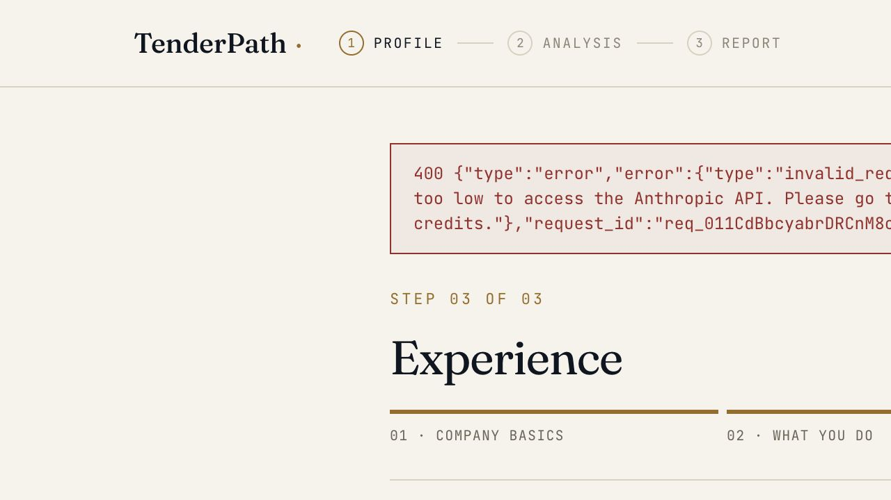
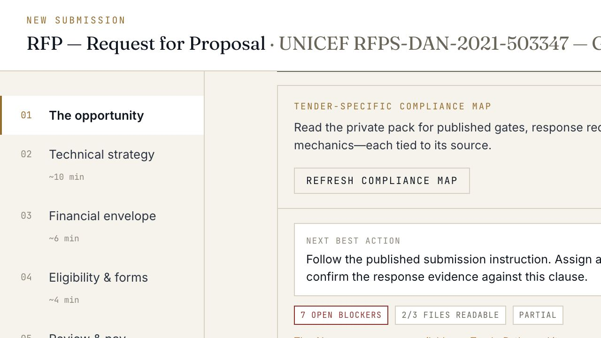
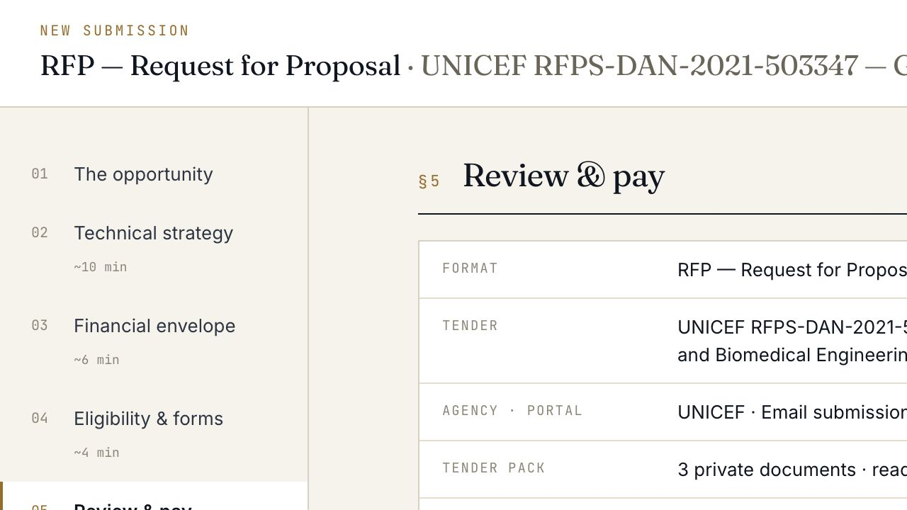
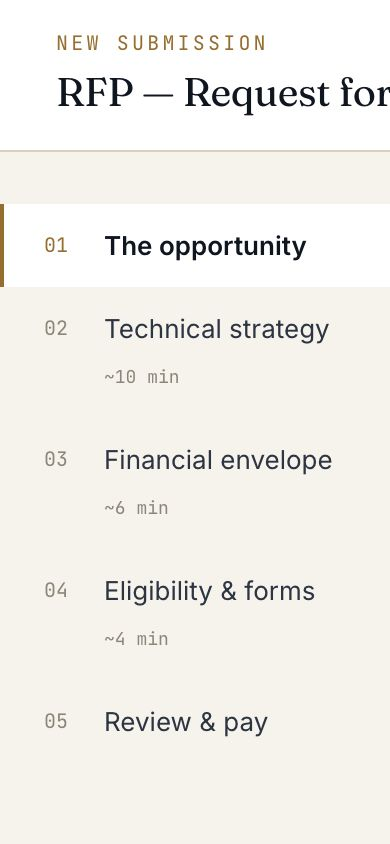
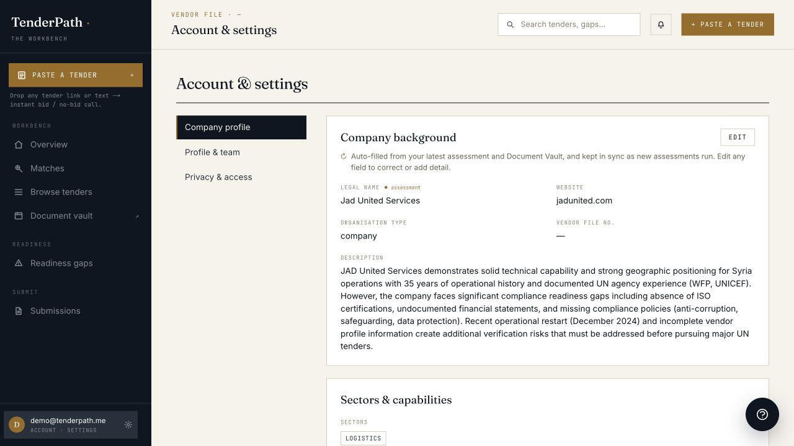
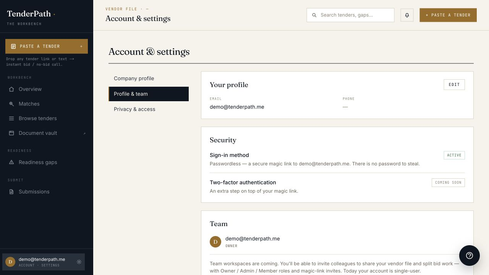
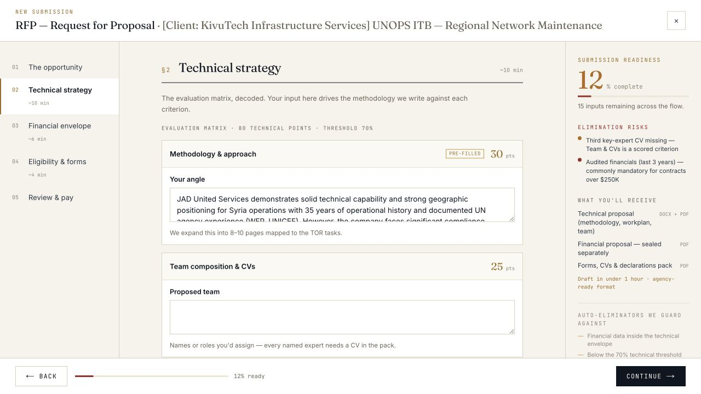

# TenderPath A–Z ICP stress test

Date: 2026-07-19
Target: `https://www.tenderpath.me`
Scope: production user journey, responsive behavior, failure states, persistence, portal hand-off, private document handling, requirement tracking, review gate, demo isolation, and operational health.

## Executive decision

- **Service provider ICP:** high product relevance, but onboarding should pause until the activation, notice-channel, upload, PDF, and demo-isolation P0s are fixed. Current readiness: **4/10**.
- **UN-bid consultancy ICP:** strong strategic fit but structurally unsupported today. The product is one vendor, one user, one active draft per submission format, with one global vault. Do not onboard a consultancy into one shared account. Current readiness: **2/10**.
- **Best early-adopter lane:** direct vendors with one legal entity, desktop use, and a founder-assisted intake after the P0 stabilization sprint.

## Test personas

### ICP 1 — direct service provider

**NileMed Field Engineering** — a small biomedical and plant-maintenance provider operating in Egypt and Kenya. Capabilities include oxygen-plant repair, cold-chain and biomedical systems maintenance, commissioning, emergency servicing, spare parts, and training.

Tender fixture: UNICEF RFPS-DAN-2021-503347, “Global LTAs for Oxygen Generation Plant Repair and Biomedical Engineering Technical Services,” including the base notice, Amendment 1, revised TOR, proposal form, and Q&A.

### ICP 2 — UN-bid consultancy

**Sahara BidWorks Advisory** — a boutique consultancy preparing UN bids for several client companies. It needs explicit client selection, separate profiles and evidence libraries, multiple simultaneous RFPs, scoped collaborator roles, approval history, and no cross-client prefill.

Two simulated clients were used: NileMed Field Engineering and KivuTech Infrastructure Services.

## Journey scorecard

| # | Journey step | Health | Evidence and result |
|---|---|---|---|
| 1 | Public entry | Yellow | Clear outcome positioning, but the hero says “Paste any UN or donor tender” while the dominant interaction is an email invite form rather than a paste input. |
| 2 | Sign-in | Green | Magic-link and demo/password paths are easy to understand; no-card copy lowers friction. |
| 3 | Assessment intake | Green/Yellow | Manual no-website path supports realistic company details and geography. Copy inconsistencies reduce trust: four vs five readiness dimensions, and `75open` is missing a space. |
| 4 | Assessment execution | **Red** | Production returns an Anthropic 400 insufficient-credit error. Raw provider JSON and a request ID are briefly exposed in the UI. |
| 5 | Assessment → dashboard activation | **Red** | The failed assessment becomes a routing trap: opening downstream dashboard/submission routes returns the user to the failed assessment report. |
| 6 | Tender source and submission channel | **Red** | The user-entered, notice-correct email route is preserved in the summary, but the checklist simultaneously asserts “UNGM electronic submission.” Notice-specific instructions are not authoritative throughout the UI. |
| 7 | Tender-pack upload | **Red** | Browser upload remained at `Uploading 0%` with no visible error. The same DOCX succeeded through the production API, isolating the problem to the direct browser upload/UI path. |
| 8 | Extraction and pack truth | **Red** | DOCX extraction worked; the Amendment PDF failed. The UI still called all three documents “ready,” while the compliance map correctly reported only 2/3 readable. An unreadable amendment is a higher-authority failure than the UI’s next action suggests. |
| 9 | Compliance map | Yellow/Green | When the AI processor was unavailable, conservative exact-quote extraction completed without a 500, clearly labeled the result `partial`, persisted status changes, and made the map stale/disabled decisions after a document-role change. Titles were generic and seven BLOCKs were produced while the amendment was unreadable. |
| 10 | Technical, financial, eligibility intake | Yellow | The procurement-specific separation and elimination-risk framing are strong. A prior vendor’s assessment text was prefilled into the methodology for the active tender. |
| 11 | Review and start gate | Yellow | The summary carries format, tender, channel, pack, hand-off readiness, requirement blockers, deadline, completeness, and elimination risks into one decision surface. No order was created during the test. |
| 12 | Save/resume | Yellow | Requirement status and field state persisted across reloads. Closing the wizard showed no obvious “resume draft” control; starting RFP again silently reopened the one saved RFP. |
| 13 | Mobile, 390×844 | **Red** | The step rail consumes the first screen, the tender title is cropped, and no tender inputs are visible without a long scroll. There was no page-level horizontal overflow, but the flow is not practically usable on mobile. |
| 14 | Owner-only API boundary | Green, limited evidence | Unauthenticated draft, vault, and download requests returned 401. After demo reset, the previously valid private-file URL returned 404 with the new session. This is not a two-real-tenant test. |
| 15 | Demo/profile isolation | **Red** | A no-cookie demo reset cleared vault files and orders, but the Company profile still displayed a prior visitor’s vendor name, website, geography, sectors, and assessment description. That data was materialized into a later client’s RFP. |
| 16 | Consultancy multi-client model | **Red** | No client workspace or legal-entity selector exists. Starting a second RFP reopened the first and editing it overwrote the first client. The vault has no client partition. The account page explicitly states team workspaces are coming and the product is single-user today. |
| 17 | Operational health | Yellow/Red | Shallow health was 200/OK. Deep health returned 503/degraded because the browser worker was unreachable with HTTP 404; UNGM, World Bank, and TED EU were fresh, but the worker failure threatens JS-rendered/anti-bot source reliability. |

## Highest-priority findings

### P0 — fix before the next early adopter

1. **Restore assessment execution and add a real fallback.** Replenish/route model capacity, sanitize provider failures, and allow a degraded assessment or safe retry without trapping the account.
2. **Make the notice-specific submission channel authoritative.** A manual email route must override any agency-level UNGM default in the checklist, guide, and review summary.
3. **Repair direct browser upload and expose terminal failure.** A 0% upload may not spin silently. Add timeout, retry, failure reason, and server correlation ID.
4. **Treat unreadable amendments/Q&A as a hard authority gap.** Pack readiness cannot be `ready` when an amendment fails extraction. The next action must be to restore readability or manually confirm the amendment before relying on lower-authority requirements.
5. **Reset or isolate the public demo company profile.** The shared demo currently exposes and reuses prior company data across sequential visitors.

### P1 — next production sprint

6. **Make the wizard usable on mobile.** Replace the full-height step rail with a compact step indicator/drawer and keep the active form above the fold.
7. **Make saved drafts first-class.** Show named drafts in “In flight,” provide Resume/Duplicate/New, and stop hiding the only draft behind another Start action.
8. **Strengthen compliance fallback priority.** Preserve the good stale-map behavior, but surface source authority and make “amendment unreadable” outrank generic clause work.
9. **Resolve trust-copy inconsistencies.** Four/five dimensions, `75open`, cropped headers, and “3 documents ready” despite one failed extraction.
10. **Repair the browser worker health check/deployment.** A production deep-health 503 should be triaged before crawler coverage is trusted.

### Consultancy enablement — separate sprint, not a UI-only patch

1. Add an explicit account mode: `vendor` or `adviser`.
2. Introduce a client/legal-entity object and require `client_id` on profiles, matches, vault documents, drafts, submission orders, proposal packages, exports, and audit events.
3. Replace the one-draft-per-format model with addressable draft IDs and a client-scoped draft list.
4. Add client-scoped vault views, labels, retention/deletion, and attachment controls.
5. Add Owner/Admin/Member/Reviewer roles plus approval events and client-specific access grants.
6. Add automated negative tests for cross-client reads, downloads, prefills, exports, search, and support access.
7. Use per-client envelope-encryption keys if TenderPath must be cryptographically unable to inspect content without an explicit, auditable grant. Current route authorization and support-access copy do not prove “sealed even from super admins.”

## What is already worth keeping

- The procurement-specific wizard structure is substantially better than generic SaaS form patterns.
- The official-notice link, private document workspace, no-portal-password boundary, portal checklist, compliance map, and elimination-risk rail create a credible end-to-end product spine.
- Status changes persist, and changing source-document roles correctly invalidates the map and disables decisions until refreshed.
- The review surface preserves workflow continuity rather than turning the result into a disconnected report.
- Owner-gated downloads and time-bound support-access language are the right direction; they need stronger evidence and client scoping for consultancy use.

## Evidence

### Assessment provider failure

### Partial compliance map after one unreadable amendment

### Review gate preserves tender, channel, pack, and blocker state

### Mobile wizard front-loads the full step rail

### Shared demo profile retains a previous company

### Consultancy account is explicitly single-user

### A different client receives the prior vendor's strategy prefill

## Evidence limits

- The test intentionally stopped before creating a service order, payment, supplier-portal submission, or outbound message.
- A true cross-tenant test with two independently owned production accounts was not performed. The API boundary evidence is limited to unauthenticated access and post-reset invalidation.
- Encryption at rest, key custody, backup access, and super-admin cryptographic exclusion were not verified. Product copy and route guards are not sufficient evidence for that claim.
- The UNICEF case is a historical real tender fixture with a test deadline substituted to keep the workflow active.

## Recommended shipping decision

Ship a short **trust-gate stabilization sprint** first: assessment fallback, channel authority, browser upload, PDF/amendment truth, demo profile isolation, and mobile wizard. Then onboard one direct service provider with a desktop/founder-assisted path. Hold the consultancy ICP until client entities, client-scoped drafts/vaults, and role-based access exist.
