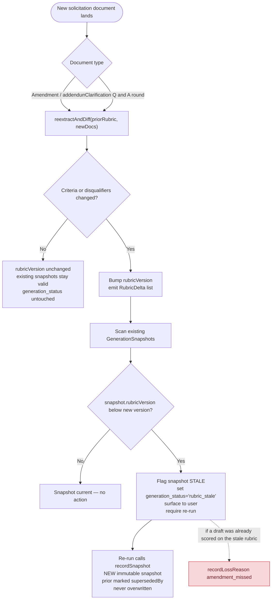

# Amendment / Q&A → version-bump → stale-snapshot flow (Sprint 3)

Unambiguous reference for the versioning logic. UN tenders issue **amendments / addenda** to
solicitation documents and publish **clarification (Q&A) rounds** that become binding — either can
change the scoring rubric or the disqualifiers mid-draft. This is the canonical re-run trigger.

## Legend / invariants

- **Entry point:** any new document in the solicitation set (amendment, addendum, or published Q&A)
  triggers `reextractAndDiff(priorRubric, newDocs)`.
- **No change → no version churn.** If neither criteria nor disqualifiers move, `rubricVersion` is
  untouched and nothing is invalidated. Re-extraction is cheap; version bumps are not free, so only
  a real delta bumps.
- **Change → bump once, fan out.** A single `rubricVersion` bump; `RubricDelta` records exactly what
  moved (e.g. a criterion's `maxScore`, a `gatingThreshold`, a disqualifier `rule`, a lot's
  per-lot disqualifier — `RubricDelta.lotId` is present for lot-scoped changes, absent for
  notice-wide changes).
- **Stale detection is purely version comparison.** Any `GenerationSnapshot` with
  `rubricVersion` below the new version is stale by definition — no fuzzy matching.
- **Stale → `generation_status = 'rubric_stale'`.** GATE 0 (2026-05-24) resolved this as a new
  status value alongside `pending` / `generating` / `ready` / `needs_remediation` / `failed`.
  `generation_status` is `TEXT` with no CHECK constraint, so widening is purely a TypeScript
  change — see `GenerationStatus` in `src/lib/proposal-package/types.ts`. UI surfaces that read
  `generation_status` (the Sprint 25 LEFT JOIN pattern in `getViewerActivity`) consume the new
  value alongside the existing five.
- **Re-run never overwrites (hard guardrail).** A re-run produces a *new* immutable snapshot; the
  prior one is preserved and marked `supersededBy`. This is the "no silent overwrite" standard made
  mechanical.
- **Red node = the loss-signal capture.** If a draft was already scored against the now-stale rubric,
  emit `recordLossReason(amendment_missed)` — this is the highest-value training signal and the exact
  failure class that loses scoring points in real tenders.
